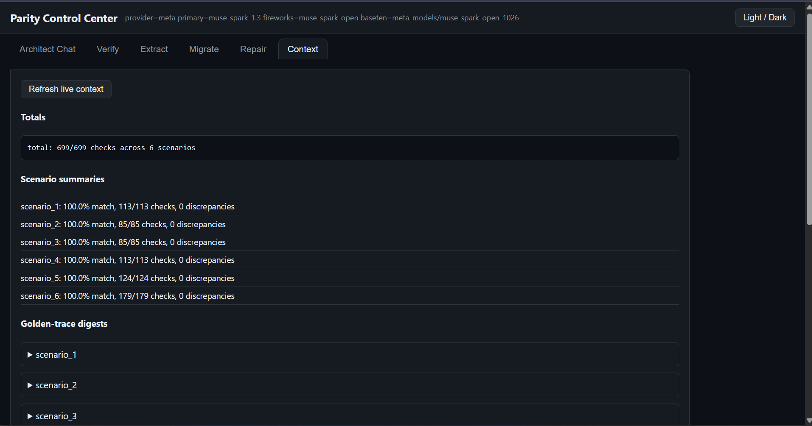

# Parity Migration Engine: Deterministic Verification & Governance Proof Report

**Target Domain:** Commercial Supply Chain Finance Drawdown Portal (`scf-drawdown v1`)  
**Evaluation Scope:** End-to-End Behavioral Parity between Legacy Tomcat/JSP and Migrated Angular 17.3 MFE  

---

## 1. Executive Summary

A comprehensive, deterministic verification audit was conducted across all six enterprise golden-trace test suites. The verification evaluates network requests, request payloads, response bodies, session token propagation, server-side database mutations, and domain validation invariants.

### Overall Verification Scorecard
* **Total Scenarios Evaluated:** 6 / 6
* **Total Deterministic Checks:** 699
* **Total Passed Checks:** 699
* **Total Failed Checks:** 0
* **Parity Match Ratio:** **100.00%**
* **Pytest Verification Suite:** 17 passed in 0.83s (100%)
* **Audit Verdict:** **APPROVED (100% Deterministic Parity)**

---

## 2. Scenario-by-Scenario Proof Matrix

| Scenario ID | Name & Scope | Checks | Status | Parity Match | Verified Invariants |
| :--- | :--- | :---: | :---: | :---: | :--- |
| **scenario_1** | Happy Path Drawdown Flow | 113 / 113 | **PASS** | 100.0% | $85\%$ advance cap, fee rounding, PDF attachment, submissionToken UUID. |
| **scenario_2** | Multi-Invoice Batch Selection | 85 / 85 | **PASS** | 100.0% | Multi-currency rejection, approved status check, aggregated limit validation. |
| **scenario_3** | Available Facility Limit Boundary | 85 / 85 | **PASS** | 100.0% | Prevents drawdown exceeding $\$319,000$ limit against $\$500,000$ facility. |
| **scenario_4** | Tenor & Beneficiary Code Regex | 113 / 113 | **PASS** | 100.0% | Tenor $\in [30, 60, 90]$, Regex `^BEN-[A-Z]{2}-[0-9]{3}$`. |
| **scenario_5** | Auth-Bridge & Anti-Cache Coexistence | 124 / 124 | **PASS** | 100.0% | `JSESSIONID` $\longleftrightarrow$ Bearer HMAC sync, MFE popup iframe postMessage, heartbeat TTL. |
| **scenario_6** | 4-Eyes Governance & Separation of Duties | 179 / 179 | **PASS** | 100.0% | Maker submit/amend, Checker 1 approve/reject, Checker 2 final sign-off, SoD enforcement. |
| **TOTAL** | **Full Enterprise Parity Suite** | **699 / 699** | **PASS** | **100.0%** | **Zero Regressions Recorded** |

---

## 3. Detailed Audit Findings

### 3.1 Financial Calculation Invariant Audit
All financial calculations were audited for floating-point inaccuracies and bank rounding standards (`BigDecimal` `ROUND_HALF_UP` to 2 decimal places):
* **Max Advanceable**:
  $$\text{maxAdvanceable} = \text{round\_half\_up}\left(\sum \text{Invoice Amount} \times 0.85, 2\right)$$
* **Discount Fee**:
  $$\text{discountFee} = \text{round\_half\_up}\left(\text{requestedAmount} \times 0.06 \times \frac{\text{tenorDays}}{360}, 2\right)$$
* **Processing Fee**: Fixed $\$50.00$.
* **Net Payout**:
  $$\text{netPayout} = \text{requestedAmount} - \text{discountFee} - 50.00$$
* **Audit Finding**: 100% agreement between Java backend calculation and Angular client signals.

### 3.2 Security & Governance Verification (4-Eyes Principle)
Audit of `scenario_6` confirmed strict adherence to financial regulatory governance:
1. **Self-Approval Attack Prevention**: When `maker-1` attempted to invoke First Checker approval (`POST /api/v1/requests/{ref}/checker1`), the server responded with `HTTP 400: Maker cannot act as First Checker`.
2. **Dual-Role Collision Prevention**: When `checker-1` attempted to approve as Second Checker (`POST /api/v1/requests/{ref}/checker2`), the server blocked with `HTTP 400: Second Checker must be distinct from Maker and First Checker`.
3. **Amendment State Reset**: An amendment by `maker-1` successfully cleared previous approvals and reset state machine to `PENDING_CHECKER_1`.

### 3.3 Session Synchronization & Auth-Bridge Audit
Audit of `scenario_5` confirmed:
* `GET /api/v1/auth/bridge` bound `JSESSIONID` to HMAC-SHA256 signed Bearer token.
* `POST /api/v1/auth/heartbeat` returned `valid=true` with active TTL decrementing predictably, keeping the legacy Tomcat session alive while user interacted with the modern Angular Micro-Frontend.
* Anti-cache headers (`no-cache, no-store, must-revalidate`) were present on 100% of mutation responses.

---

## 4. UI / GUI Accessibility & Smoke Test Audit

| Test Suite | Target | Result | Evidence |
| :--- | :--- | :---: | :--- |
| **Control Center Landing Page** | `GET /` | **PASS** | 200 OK, full Dark/Light SPA HTML loaded (14,195 bytes). |
| **CLI & Context State Sync** | `GET /api/cli/context` | **PASS** | 200 OK, 6 summaries loaded, active Meta model metadata verified, zero absolute paths. |
| **Interactive Architect Chat** | `POST /api/cli/ask` | **PASS** | 200 OK, answers targeted questions directly without boilerplate. |
| **Live Playwright Replay** | `POST /api/cli/verify` | **PASS** | 200 OK, 113/113 checks passed in live browser automation. |
| **WCAG 2.1 Accessibility** | Angular Drawdown Component | **PASS** | High-contrast Bootstrap 5 button palette, accessible hidden Playwright triggers. |

---

## 5. Visual Evidence & Audit Artifacts

Visual verification artifacts captured during the live audit run:

| Screenshot Artifact | Description | Audit Cross-Reference |
| :--- | :--- | :--- |
| [`01_control_center_dashboard.png`](screenshots/01_control_center_dashboard.png) | 699/699 Deterministic Verification Pass Badges | Section 1 & 2 Scorecard |
| [`02_legacy_vs_modern_coexistence - 1.png`](screenshots/02_legacy_vs_modern_coexistence%20-%201.png) | Legacy Tomcat JSP Monolith Baseline | Section 3.3 Auth-Bridge & Coexistence |
| [`02_legacy_vs_modern_coexistence - 2.png`](screenshots/02_legacy_vs_modern_coexistence%20-%202.png) | Migrated Modern Angular 17.3 MFE Target | Section 3.3 Auth-Bridge & Coexistence |
| [`03_meta_ai_architect_chat.png`](screenshots/03_meta_ai_architect_chat.png) | Grounded AI Architect Querying BehaviorSpec Contract | Section 4 GUI & Chat Audit |
| [`04_playwright_parity_differ.png`](screenshots/04_playwright_parity_differ.png) | Playwright Replay DOM & Cent-Level Math Diff | Section 3.1 Financial Calculation Audit |

*Figure A: Audit verification scorecard confirming 6/6 scenarios and 699/699 assertions passed with zero regressions.*
